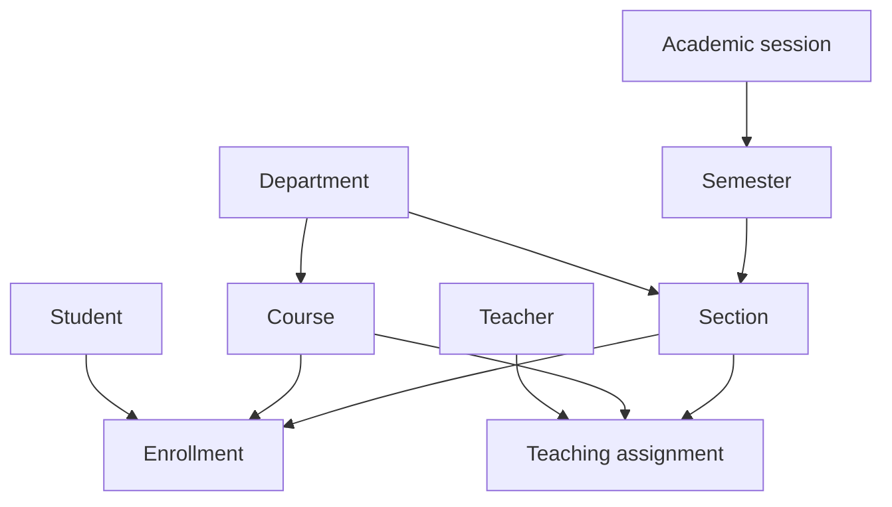
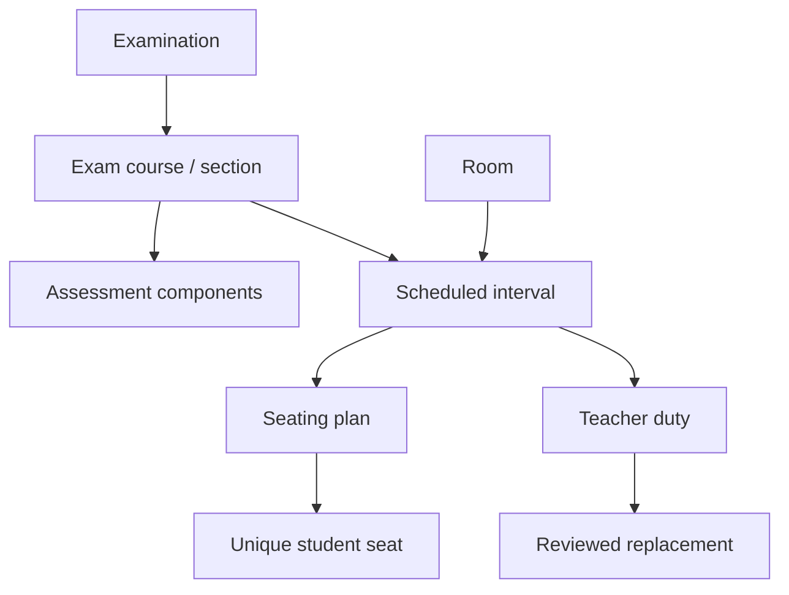
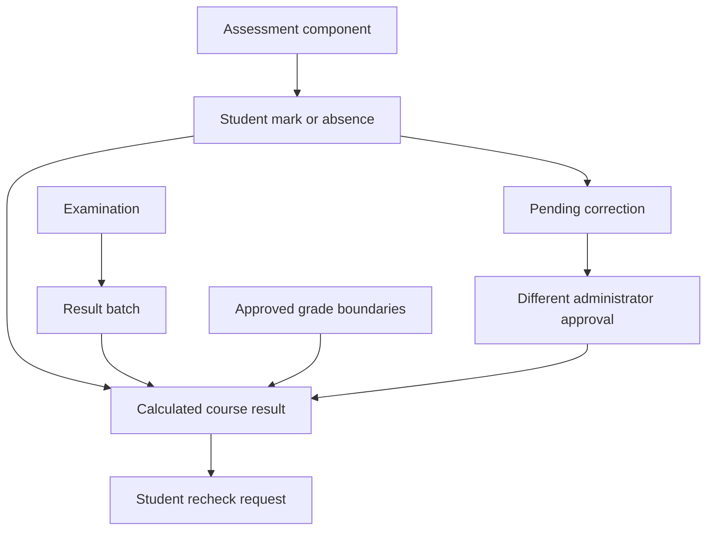

# MySQL schema and relationships

The four migrations create the application schema; they do not rename or drop existing project tables. The audited frontend had no database tables or migrations. If your independently modified installation already has tables with these names, reconcile them before running migrations. Only the isolated test runner used `migrate:fresh`.

All domain tables use InnoDB, unsigned bigint IDs, timestamps, foreign keys and restricted historical deletion. Scores/maxima/quality points use `DECIMAL(8,2)`; percentages/minimum thresholds/weights/credits use fixed two-decimal precision; grade points use `DECIMAL(4,2)`. BCMath retains intermediate precision before configurable half-up rounding. This avoids binary floating-point arithmetic in official result calculation.

| Domain | Tables |
|---|---|
| Identity | users, password_reset_tokens, student_profiles, teacher_profiles |
| Academic structure | departments, academic_sessions, semesters, sections, courses, enrollments, teacher_assignments |
| Grading | grading_schemes, grade_boundaries |
| Examinations | examinations, exam_courses, assessment_components |
| Schedules and rooms | rooms, room_unavailabilities, schedule_entries |
| Seating and documents | schedule_rooms, seating_plans, seat_assignments, admit_cards, admit_generation_runs |
| Invigilation | teacher_availabilities, duty_assignments, duty_requests, duty_replacements |
| Marks and results | mark_submissions, marks, result_batches, calculated_results, result_corrections, recheck_requests |
| Review and assistant | ai_analysis_runs, analysis_flags, forecast_runs, conversations, messages |
| Operations | backup_runs, notifications, audit_logs, jobs, failed_jobs, migrations |

Unique constraints prevent duplicate emails/roll numbers, repeated course enrollment/teaching assignments within a section, exam-course duplication, multiple schedules for an exam-course, multiple seating plans per schedule, repeated student/seat numbers per plan, duplicate student/component marks, duplicate result records and repeated recheck requests for one student result. Room interval conflicts and student overlap are checked transactionally by the scheduling service because interval exclusion is not a native MySQL unique constraint. Room and teacher locks serialize competing allocation operations. Approved academic references are immutable; history is retained through new versions and audit records.

A published schedule revision stores `examinations.supersedes_id`, copies schedule/assessment structure into draft records, and archives the previous examination only when its replacement is published. Results from the previous published batch remain historical records. Private admit-card paths are stored in the database and downloaded through ownership policies.

Result states: draft → submitted → under_review → approved → published. A return for correction moves an unapproved batch to returned. Submission states: draft/returned → submitted. Rechecks use pending/under_review/approved/rejected; approval never modifies marks. Published result corrections use separate pending and approved records with old/new scores and absence flags. Audit rows record actors, entity IDs, reasons and previous values; ordinary users have no mutation endpoints for them.

## Operational workflow extension

Migration `2026_10_12_000004_complete_operational_workflows` backfills each existing schedule's primary room into `schedule_rooms` and room IDs into existing seat/duty assignments. Multi-room seats are unique by plan/room/seat number, while student uniqueness remains per plan. Conflicts compare every allocated room and shared student interval.

`duty_requests` records the authenticated teacher, paper duty, exact requested time, 48-hour deadline, status, administrator and decision. Requests and replacements are separate from confirmed availability: the original duty remains assigned until cover is approved. Candidate proposals reserve staff against competing overlapping proposals. Approval either promotes existing standby staff or creates room-specific cover, preserving old assignment history.

`forecast_runs` stores the authorized history, model version, sample size, estimate and uncertainty. `backup_runs` records actual archive status, checksum, bytes and verification time. Archives contain signed manifests and hashes for the database SQL and each private document. Restore targets are isolated databases; the active application database is never silently replaced.
